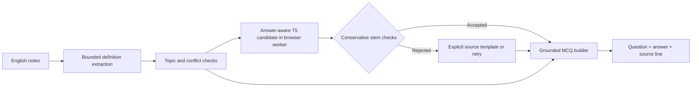

# BloomPath — Explainability and Evidence Traceability

> **Scope:** Educational practice prototype. Explanations show source support and deterministic adaptation rules; they do not establish psychometric validity, causal explanations of learning, or guaranteed correctness.

## 1. What BloomPath explains

BloomPath provides two different kinds of explanation:

1. **Question evidence:** which extracted term, definition, topic and source line support the intended correct option.
2. **Adaptive selection:** why the next task level or topic was selected under the published session policy.

These must be distinguished from an explanation of the internal neural-network computation. BloomPath does not claim mechanistic interpretability of the T5 model.

## 2. Question lineage



The answer key is anchored to a term or definition extracted from the learner's notes. The generator proposes wording, but the grounded builder and validators constrain which items are shown. A source template is not presented as AI-generated text. Source notes themselves can be wrong; grounding is **not** independent factual verification.

### Question provenance fields

For each item, preserve or display where supported by the application: source topic, extracted term, source definition/line, question mode (AI accepted or source template), correct choice, distractor choices, and explanation. Exact exported field names must follow the actual application schema, not this conceptual list.

### Three task levels

| Level | Observable task | Important boundary |
|---|---|---|
| Recall | Match a named term to its definition | Primarily recognition |
| Connect | Identify a term from a source description | Stem may be AI-generated or a labeled template |
| Challenge | Identify a source-consistent term–definition pairing | Not proof of higher-order reasoning |

Difficulty labels are task heuristics, not calibrated item difficulty estimates.

## 3. Answer and distractor rationale

The correct answer comes from the notes. Distractors are related concepts drawn from the same topic. In Challenge mode, distractors deliberately pair a term with another concept's definition. The user should be able to inspect the relevant source evidence after answering.

Validation rejects candidates that violate implemented structural and source-coverage checks, including malformed stems, unsupported wording, dropped defining attributes, and answer leakage. These checks reduce known failure modes; they do not guarantee a unique or unambiguous answer.

## 4. Adaptive policy — a transparent state machine

- The session starts at **Connect**.
- **Two consecutive correct responses** increase the task level, up to Challenge.
- **One incorrect response** decreases the task level, down to Recall.
- Within the available unseen concepts, selection favors the weakest observed topic.
- Confidence and response time support reflection but **do not** affect grading or difficulty changes.

Example: A learner starts at Connect, answers twice correctly, and moves to Challenge. A subsequent incorrect answer moves the learner down to Connect. The policy explains a selection rule; it does not diagnose why the learner erred.

## 5. Learner-facing explanations

A useful answer review should state:

- **Your answer:** the chosen option.
- **Expected answer:** the keyed option.
- **Evidence:** the source line/definition supporting the key.
- **Why this item was shown:** topic and level selection, when available.
- **What happens next:** a rule-based description of the level change or retention.

Do not label model confidence, observed accuracy, or a Wilson interval as a probability that the learner truly understands the subject.

## 6. Evaluation and reproducibility

The project README describes checks against 34 source facts, three task levels, and six reproducible learner simulations, with outputs in `docs/evaluation.json`. Treat these as development evaluations unless the artifacts demonstrate a broader protocol. The following commands should be run and their actual outputs inspected before making release claims:

```sh
npm ci
npm run model:fetch
npm run check
npm test
npm run evaluate
npm run build
```

`npm test` evaluates core behavior and reference-bank structure. `npm run evaluate` runs the quantized model and learner simulations. Neither substitutes for educator review or real learner validation. Browser testing is documented separately in `docs/TESTING.md`.

## 7. Known explanation failure modes

| Failure mode | Mitigation / disclosure |
|---|---|
| Incorrect source notes | Explain that source-grounding does not verify truth |
| Ambiguous definitions | Conflict checks; educator review remains necessary |
| Weak or repeated distractors | Topic-local distinct choices; small topics limit diversity |
| Misleading AI stem | Conservative rejection; explicit source-template fallback |
| False inference of mastery | Report observed responses, not certified ability |
| Unstable generated wording | Record source evidence and generation mode; re-evaluate model revisions |
| Untrusted user text | Treat imported notes as data, not commands |

## 8. Privacy and authority

The released architecture performs inference on the learner's device and does not require an inference API, account, backend, database, or telemetry tracker. Browser-hosted static/model assets are still downloaded from hosting infrastructure; avoid claiming that no network traffic ever occurs. Answer keys reside in client memory, so the system is not suitable for secure examinations.

**Human review boundary:** Teachers and learners remain responsible for checking source correctness, question ambiguity, and educational suitability. BloomPath is an explainable practice aid, not an accredited diagnostic instrument.

## 9. Source-of-truth references

- [`README.md`](README.md) — feature and deployment scope
- [`src/core.ts`](src/core.ts) — parsing, item building and adaptive rules
- [`docs/evaluation.json`](docs/evaluation.json) — evaluation artifact
- [`docs/TESTING.md`](docs/TESTING.md) — browser testing notes
- [`tests/question-bank.json`](tests/question-bank.json) — reference questions, not claimed AI output
