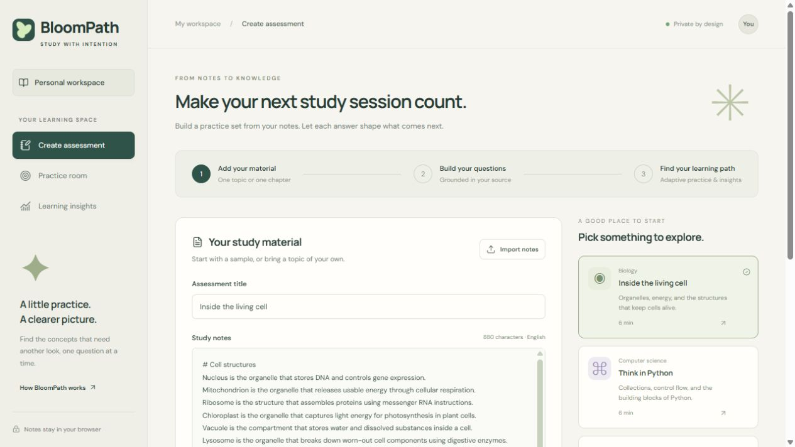
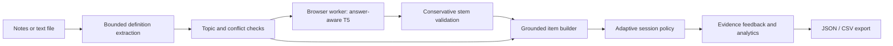

# BloomPath — Personalized MCQ Generator for Diagnostic Tests

Turn English study notes into source-grounded multiple-choice practice. BloomPath generates questions on the learner’s device, changes the next task after each response, and explains the evidence behind every answer and every adjustment.

[](https://github.com/Janicebenita/personalized_mcq_generator_hidevs/actions/workflows/verify.yml)

**HiDevs project:** [Personalized MCQ Generator for Diagnostic Tests](https://app.hidevs.xyz/projects/2). Built by Janice Benita with AI coding assistance. Educational prototype; not a validated diagnostic or high-stakes assessment system.

## Try it

**[Open the live app](https://bloompath-mcq.vercel.app)** � **[Watch the 2-minute 27-second demo on Google Drive](https://drive.google.com/file/d/1GuStRFiFee0ufSnXvgIFJAi9wtPU8myv/view)** � [Download the demo](https://github.com/Janicebenita/personalized_mcq_generator_hidevs/releases/download/v1.0.0/bloompath-demo.mp4)

The narrated video uses actual browser screenshots from synthetic practice sessions, not a continuous screen recording. A [transcript](docs/demo/transcript.txt), [session export](docs/demo/browser-session.json), and [model evaluation](docs/evaluation.json) make the demonstration reviewable.




1. Choose Biology, Python, or Earth science, or paste your own notes.
2. Select **Browser AI + source checks** and build an assessment. First use downloads approximately 97 MB of model files plus the WebAssembly runtime; allow a few minutes on a slow connection. No key or AI-service account is needed. **Source practice** works instantly without generative AI.
3. Review question provenance, then enter the practice room.
4. Answer, record confidence, and inspect the answer explanation and source line.
5. View topic accuracy, difficulty changes, confident misses, and a concept review. Export JSON or CSV.

## What makes the assessment personalized

| Criterion                       | Implementation                                                                                                                                                                                                     | Evidence                                                         |
| ------------------------------- | ------------------------------------------------------------------------------------------------------------------------------------------------------------------------------------------------------------------ | ---------------------------------------------------------------- |
| Question relevance              | Answer-aware T5 generation uses a specific term and source definition. Conservative checks reject unsupported words, answer leaks, dropped defining attributes, low source coverage, and malformed stems.          | [Model evaluation](docs/evaluation.json), [core](src/core.ts)    |
| Correct answers and distractors | The answer comes from the notes. Four distinct choices use related concepts from the same topic. Challenge questions deliberately mismatch term–definition pairs. Source lines and explanations accompany the key. | Question invariants across 34 source facts and three task levels |
| Adaptation                      | Starts at Connect. Two consecutive correct answers raise the level; one incorrect answer lowers it. Selection favors the weakest topic among unseen target concepts.                                               | Six reproducible learner simulations in the evaluation report    |
| UI and learning insights        | Responsive interface, semantic labels, keyboard choices, reduced-motion support, confidence reflection, transparent policy, and exports.                                                                           | Browser walkthrough and [testing notes](docs/TESTING.md)         |

### Three different practice tasks

- **Recall:** select the definition of a named term, with less similar distractors where the topic offers enough choices.
- **Connect:** select the term matching a source description, using an accepted AI stem or a labeled source template.
- **Challenge:** compare related term–description pairings and select the pair consistent with the notes. Distractors attach a term to another concept’s definition.

Levels describe task heuristics, not psychometric calibration or demonstrated higher-order reasoning. Small four-term topics limit distractor variety. Confidence and answer time support reflection; neither alters grading. A correct answer cannot establish that a learner was not guessing.

## Local setup

Requirements: Node.js 24 or newer, npm, and a modern browser with WebAssembly. No Python or Docker is required to run the released application.

```powershell
git clone https://github.com/Janicebenita/personalized_mcq_generator_hidevs.git
cd personalized_mcq_generator_hidevs
npm ci
npm run model:fetch
npm run dev
```

Open the localhost URL printed by Vite. Model downloads are SHA-256 checked against the committed manifest. If downloads fail, `npm run dev` still supports **Source practice**. AI mode reports its failure and offers retry/source practice; it never silently claims a template question was generated by AI.

```sh
npm run check
npm test
npm run evaluate
npm run build
```

`npm test` covers the core module and supplied reference-bank structure. `npm run evaluate` actually runs the quantized model, checks question structure, and produces two different learner paths per subject. These are separate from browser verification and human review.

## Input format and scope

Paste English definitions or import a UTF-8 `.txt`/`.md` file up to 50 KB. Use one definition per line, 4+ distinct related terms per heading, up to 24 extracted concepts per assessment.

```text
# Collections
List is a mutable ordered collection of items in Python.
Tuple is an immutable ordered collection of items in Python.
Set is an unordered collection of unique items in Python.
Dictionary is a mutable mapping from unique keys to values in Python.
```

`Term :: definition`, `means`, `refers to`, and `are` are also supported. Conflicting entries and identical definitions shared by different terms are excluded. Skipped lines and small topics receive visible warnings. Editing notes clears the prior assessment and answers. Reloading clears the session.

This release does not parse arbitrary PDF/DOCX documents, interpret diagrams, generate code-execution exercises, or support all languages. The user-supplied Word question bank informs the evaluation references in [tests/question-bank.json](tests/question-bank.json); its questions are not presented as generated output. The original document is not published.

## Architecture



TypeScript/Vite frontend; Transformers.js 4.3.2; ONNX Runtime WebAssembly in a dedicated worker; Lucide icons. No backend, database, inference API, API secrets, paid AI service, or telemetry tracker. Vercel serves static assets on the existing Hobby workspace. The model is loaded on demand, so learners can use instant source practice without downloading weights.

Model: [valhalla/t5-small-qg-hl](https://huggingface.co/valhalla/t5-small-qg-hl), revision `9fdee3255929ba5f0b9d45e76e1e0184f664a368`, an answer-aware model trained on SQuAD. Converted with Optimum and dynamically quantized for MatMul/Gather, including decoder subgraphs. The released weights, sizes, and checksums are in [model-manifest.json](docs/model-manifest.json). Upstream model card lists MIT; pretrained T5 originates from Google. See [third-party notices](docs/THIRD_PARTY.md).

## Deployment and CI

Vercel build command: `npm run model:fetch && npm run build`; output directory `dist`; Node 24. Only static hosting is used. The GitHub release stores versioned model assets; builds verify their hashes before serving them. No environment variables are required. GitHub Actions runs type checks, npm audit, core coverage gates, a production build, and a separate real-model evaluation job. Coverage gates apply to `src/core.ts`, not to the entire UI or worker.

## Limits and interpretation

Automatic checks constrain generation; they cannot guarantee truth, unique interpretation, or educator-level distractor quality. Incorrect source notes remain incorrect. Similar meanings with different wording can escape conflict checks. A teacher should review the question set before classroom use. The application tests recognition of definitions, not the full range of learning objectives in a subject.

Topic results display observed accuracy and counts. The session-level Wilson interval communicates sampling uncertainty, but does not correct for adaptive selection, item dependence, or source bias. It is not a confidence interval for a learner’s general ability. Answer keys are present in client memory, so the application is for practice, not secure examinations.

## License

Application code: MIT. Model and dependency licenses remain with their respective authors. No leaderboard score or clinical/educational validation is claimed.
