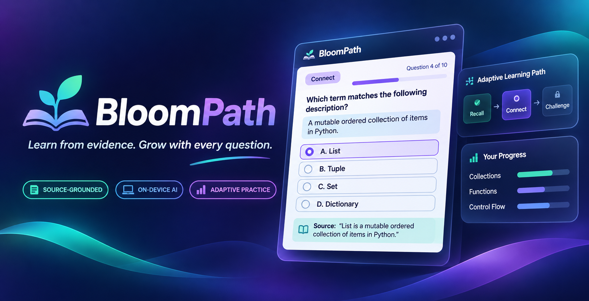
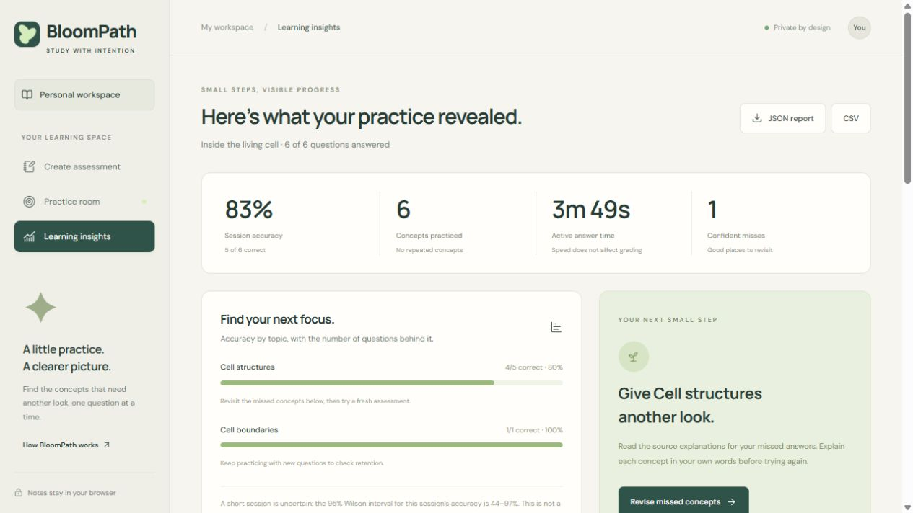
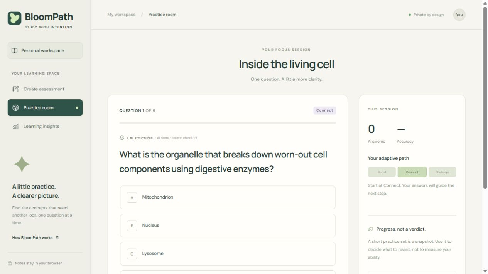
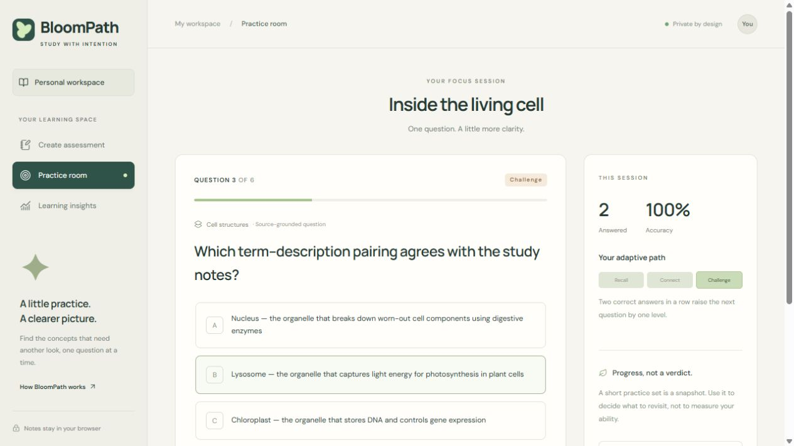
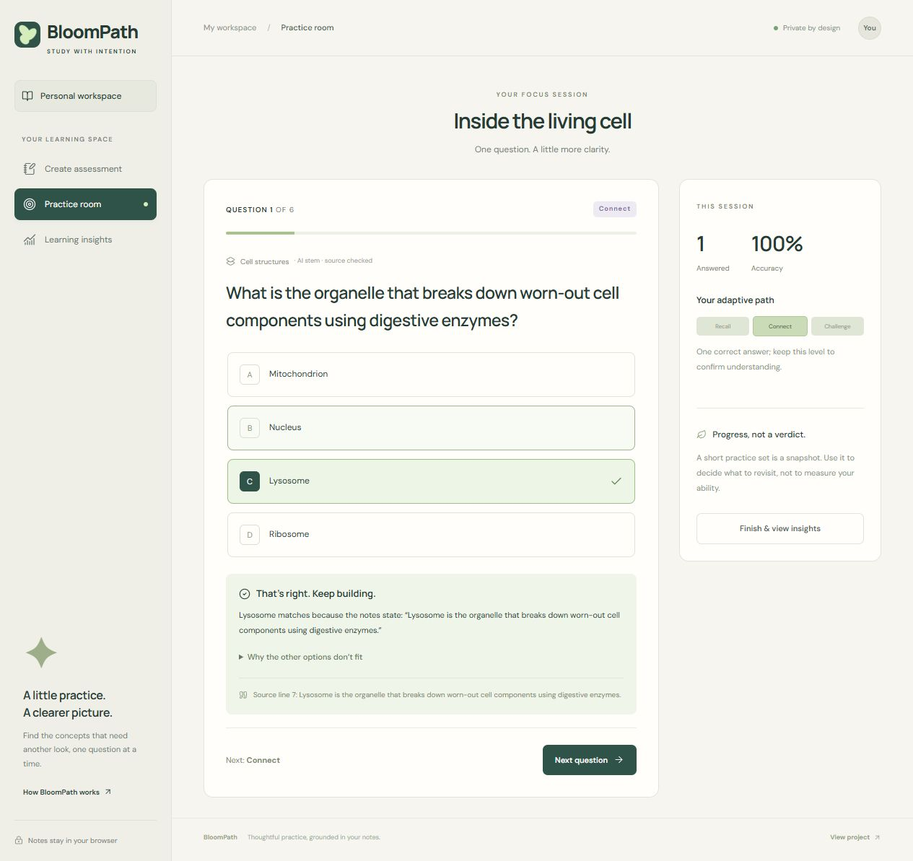
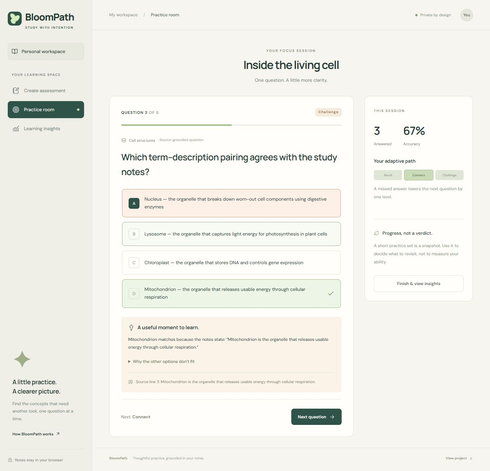
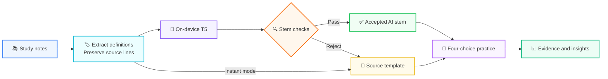
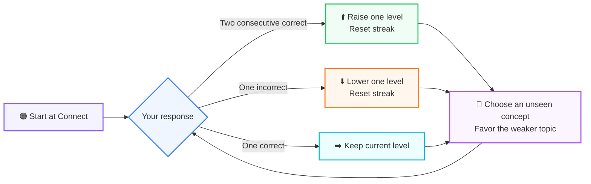
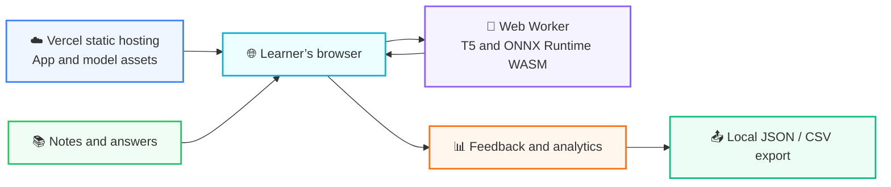

<div align="center">



<br />

# 🌱 BloomPath

### Learn from evidence. Grow with every question.

**Personalized MCQ Generator for Diagnostic Tests · HiDevs · Education**

<p>📚 Source-Grounded &nbsp; · &nbsp; 🧠 On-Device AI &nbsp; · &nbsp; 🎯 Adaptive Practice</p>

<a href="https://bloompath-mcq.vercel.app"></a>
<a href="https://youtu.be/7qaD6AOwUzg"></a>
<a href="https://github.com/Janicebenita/personalized_mcq_generator_hidevs/actions/workflows/verify.yml"></a>

<br /><br />


<br /><br />


<sub>Coverage applies to <code>src/core.ts</code> only. These figures are verification results, not a HiDevs score or evidence of educational validity.</sub>

<br /><br />

[🚀 Live app](https://bloompath-mcq.vercel.app) · [🎬 YouTube demo](https://youtu.be/7qaD6AOwUzg) · [☁️ Drive copy](https://drive.google.com/file/d/1GuStRFiFee0ufSnXvgIFJAi9wtPU8myv/view) · [📦 Release](https://github.com/Janicebenita/personalized_mcq_generator_hidevs/releases/tag/v1.0.0)

</div>

_The hero is a project illustration. The gallery below contains actual browser screenshots._

---

## 🧭 Explore the project

[Try it](#-try-bloompath) · [Features](#-what-you-can-do) · [Screenshots](#-inside-the-app) · [Adaptation](#-adaptation-you-can-follow) · [Evidence](#-verification-and-evidence) · [Setup](#-run-locally) · [Documentation](#-documentation)

## 🚀 Try BloomPath

Study notes tell you what to read. A useful practice session should also help you find what needs another look. BloomPath turns clear English definitions into multiple-choice questions, adjusts the next task using your responses, and keeps the source evidence beside each answer.

| Open                                                                                                                                      | What you will find                                                           |
| ----------------------------------------------------------------------------------------------------------------------------------------- | ---------------------------------------------------------------------------- |
| 🌍 **[Public live app](https://bloompath-mcq.vercel.app)**                                                                                | A working assessment studio, practice room, and learning dashboard on Vercel |
| 🎥 **[YouTube walkthrough](https://youtu.be/7qaD6AOwUzg)**                                                                                | A 2:27 public demonstration on Janice Benita’s channel                       |
| ☁️ **[Google Drive video](https://drive.google.com/file/d/1GuStRFiFee0ufSnXvgIFJAi9wtPU8myv/view)**                                       | The same demo with view-only access for anyone with the link                 |
| 📥 **[Download the demo](https://github.com/Janicebenita/personalized_mcq_generator_hidevs/releases/download/v1.0.0/bloompath-demo.mp4)** | H.264/AAC video at 1920 × 1080                                               |

**Start in five steps:**

1. 📚 Choose **Biology**, **Python**, or **Earth science**, or paste your own notes.
2. 🧠 Select **Browser AI + source checks** and build an assessment.
3. 🔎 Review source concepts and question provenance, then enter the practice room.
4. 🎯 Answer, record confidence, and read the explanation and source line.
5. 📊 Explore topic results, revisit missed concepts, and export JSON or CSV.

> [!TIP]
> First AI use downloads approximately **97 MB of model files**, plus the WebAssembly runtime. Allow a few minutes on a slow connection. Choose **Source practice · Instant** for template-based questions without downloading the AI model.

The demo uses actual browser screenshots from synthetic practice sessions with synthetic voice narration. It is not a continuous screen recording. Its [transcript](docs/demo/transcript.txt) and [session export](docs/demo/browser-session.json) are available for review.

## ✨ What you can do

| Capability                               | How BloomPath implements it                                                                                      |
| ---------------------------------------- | ---------------------------------------------------------------------------------------------------------------- |
| 📚 **Generate from your material**       | Extracts definitions and topic headings from pasted notes or `.txt` / `.md` files, retaining source line numbers |
| 🧠 **Run AI on your device**             | An answer-aware, quantized T5 model writes stems in a dedicated browser worker                                   |
| 🔍 **Inspect question provenance**       | Shows which stems passed source checks and which use source templates                                            |
| 🧩 **Practice with related distractors** | Builds four distinct choices from concepts in the same topic, with explanations after grading                    |
| 🎚️ **Adapt the next task**               | Moves between Recall, Connect, and Challenge using an explicit response policy                                   |
| 🧭 **Focus on weaker topics**            | Prioritizes weaker topics among unseen target concepts using smoothed observed accuracy                          |
| 📊 **Understand your results**           | Shows topic accuracy, question counts, confidence, answer time, and difficulty changes                           |
| 📤 **Keep your learning record**         | Exports session results as JSON or CSV; notes and responses stay in the tab’s memory                             |

## 📸 Inside the app

<table>
<tr>
<th width="50%">📚 Assessment studio</th>
<th width="50%">📊 Learning insights</th>
</tr>
<tr>
<td><a href="docs/screenshots/studio.jpg"></a></td>
<td><a href="docs/screenshots/insights-overview.jpg"></a></td>
</tr>
<tr>
<td>Choose material, set practice length, and select the question engine.</td>
<td>Review observed performance and decide what to study next.</td>
</tr>
</table>

<details>
<summary><strong>🎯 See the practice room and adaptive Challenge task</strong></summary>

### One question at a time



### A different task after two correct answers



</details>

<details>
<summary><strong>🔎 See answer evidence and remediation</strong></summary>

### Correct answer with source evidence



### A deliberate miss lowers the next task level



</details>

_All gallery images come from synthetic demonstration sessions. Click an image to inspect it at full size._

## 🔄 How it works



The AI writes the question stem. **Answers and distractors come from your notes**, rather than the model’s memory. Conservative checks reject malformed stems, answer leaks, unrelated words, weak source coverage, and omitted defining properties. Rejected stems receive a visibly labeled source question.

Conflicting definitions, repeated entries, and identical definitions shared by different terms are checked before question construction. These safeguards reduce obvious errors; they cannot prove that source material or a question is educationally correct.

## 🎯 Adaptation you can follow

### Three practice tasks

| Level                | Task                                      | Example                                                                                                |
| -------------------- | ----------------------------------------- | ------------------------------------------------------------------------------------------------------ |
| 🟢 **1 · Recall**    | Select the definition of a named term     | “Which description matches List?”                                                                      |
| 🟣 **2 · Connect**   | Identify a term from a source description | “What is a mutable ordered collection of items in Python?”                                             |
| 🟠 **3 · Challenge** | Compare term–description pairings         | Choose the pairing that agrees with the notes; distractors attach terms to other concepts’ definitions |

### The response policy



Levels remain between **1 and 3**, and target concepts do not repeat within a session. Topic selection uses `(correct + 1) / (answered + 2)`; unseen topics start at `0.5`. Confidence and answer time support reflection and do not change the grade or task level.

The [real-model evaluation](docs/evaluation.json) includes two simulated learner profiles across all three subjects:

| Simulated response pattern | Example task path                         |
| -------------------------- | ----------------------------------------- |
| ✅ All correct             | Connect → Connect → Challenge → Challenge |
| 🌱 Needs support           | Connect → Recall → Recall → Recall        |

**These are task heuristics, not calibrated exam difficulty or validated mastery estimates.** A correct answer alone cannot establish that a learner was not guessing. Four-term topics also limit distractor variety.

## 📚 Bring your own material

Paste English definitions or import a UTF-8 `.txt` / `.md` file up to **50 KB**. Use one definition per line and at least **four distinct related terms per topic**. Each assessment uses up to **24 extracted concepts**.

```text
# Collections
List is a mutable ordered collection of items in Python.
Tuple is an immutable ordered collection of items in Python.
Set is an unordered collection of unique items in Python.
Dictionary is a mutable mapping from unique keys to values in Python.
```

Also supported: `Term :: definition`, `means`, `refers to`, and `are`. Skipped lines, conflicts, and topics that are too small receive visible feedback. Editing notes clears the prior assessment and responses; reloading clears the session.

This release accepts definition-style text. For PDF or Word material, paste the relevant definitions. It does not parse arbitrary PDF/DOCX pages, interpret diagrams, or generate code-execution exercises. Six questions from the supplied Word bank are retained as labeled [evaluation references](tests/question-bank.json), not as claimed AI output; the original document is not published.

## 🧪 Verification and evidence

| Check                         | Verified result                                                                                                           | Inspect the evidence                                                                                                   |
| ----------------------------- | ------------------------------------------------------------------------------------------------------------------------- | ---------------------------------------------------------------------------------------------------------------------- |
| ✅ Automated tests            | **56 passing** in the verified release                                                                                    | [Core tests](tests/core.test.ts) · [Reference tests](tests/reference.test.ts)                                          |
| 📏 Core coverage              | **100%** lines, statements, functions, and branches for `src/core.ts` only                                                | [Testing scope and methodology](docs/TESTING.md)                                                                       |
| 🧠 Actual model inference     | **34** sample definitions; **24** accepted stems and **10** rejected stems using source fallback in the recorded Node run | [Raw stems, options, keys, and results](docs/evaluation.json)                                                          |
| 🧭 Adaptive simulations       | **6** paths: two learner profiles per subject                                                                             | [Evaluation traces](docs/evaluation.json)                                                                              |
| 🐍 Python reference examples  | **6** fixed Python/algorithm examples checked without running uploaded code                                               | [Verification script](scripts/verify-python-reference.py)                                                              |
| 🌍 Hosted browser walkthrough | AI generation, a complete six-question session, level changes, evidence, analytics, and export checked                    | [Synthetic session export](docs/demo/browser-session.json) · [Screenshots](docs/screenshots/)                          |
| ⌨️ Interaction and recovery   | Keyboard selection/grading, invalid-input recovery, cancellation, and a narrow viewport checked                           | [Verification notes](docs/TESTING.md)                                                                                  |
| ⚙️ Continuous integration     | Type checking, formatting, audit, tests, build, and separate real-model evaluation                                        | [Latest workflow runs](https://github.com/Janicebenita/personalized_mcq_generator_hidevs/actions/workflows/verify.yml) |

**Acceptance counts are not an accuracy score.** The 34 facts are author-written examples, not an independent held-out benchmark. Browser and native execution can produce different stems. Structural checks and test coverage do not establish educational validity or predict a leaderboard score.

### How it maps to the HiDevs criteria

| Criterion                 | BloomPath’s implementation                                                                               |
| ------------------------- | -------------------------------------------------------------------------------------------------------- |
| 📚 **Question relevance** | Topic-scoped definitions, answer-aware generation, source-preserving stem checks, and visible provenance |
| 🧩 **Answer generation**  | Source-derived keys, four distinct choices, same-topic distractors, and post-answer explanations         |
| 🎚️ **Content adaptation** | Response-based task changes, weaker-topic prioritization, and a reason for each adjustment               |
| 🎨 **UI/UX**              | Focused practice flow, responsive layouts, keyboard controls, source review, and learning insights       |

## 🧱 Architecture and stack



| Layer                        | Current implementation                                                                              |
| ---------------------------- | --------------------------------------------------------------------------------------------------- |
| 🎨 Interface                 | TypeScript 5.9.3, Vite 8.3.8, Lucide icons                                                          |
| 🧠 AI runtime                | Transformers.js 4.3.2 and ONNX Runtime WebAssembly in a dedicated worker                            |
| 📦 Question-generation model | Quantized, answer-aware `valhalla/t5-small-qg-hl`                                                   |
| 🎯 Assessment engine         | Typed source extraction, stem validation, item construction, adaptive policy, and session analytics |
| 🧪 Quality checks            | Vitest 5.1.0, V8 coverage, TypeScript strict checking, Prettier, and GitHub Actions                 |
| ☁️ Hosting                   | Static assets on **Vercel Hobby**; no inference server or application database                      |
| 📤 Session data              | In-memory browser state and user-initiated JSON / CSV downloads                                     |

### 📦 Model provenance

[**valhalla/t5-small-qg-hl**](https://huggingface.co/valhalla/t5-small-qg-hl) is an answer-aware T5 model trained on SQuAD. This release uses revision `9fdee3255929ba5f0b9d45e76e1e0184f664a368`, exported with Optimum and dynamically quantized for MatMul/Gather, including decoder subgraphs.

Released weights, file sizes, and SHA-256 checksums are listed in the [model manifest](docs/model-manifest.json). Model files are distributed in the [model-v1 release](https://github.com/Janicebenita/personalized_mcq_generator_hidevs/releases/tag/model-v1). The upstream model card lists MIT; pretrained T5 originates from Google. See [third-party notices](docs/THIRD_PARTY.md) for attribution.

## ⚡ Run locally

**Requirements:** Node.js **24+**, npm, and a modern browser with WebAssembly. Python and Docker are not required to run the released app.

```powershell
git clone https://github.com/Janicebenita/personalized_mcq_generator_hidevs.git
cd personalized_mcq_generator_hidevs
npm ci
npm run model:fetch
npm run dev
```

Open the localhost URL printed by Vite. Model downloads are checked against the committed SHA-256 manifest. If downloads fail, `npm run dev` still supports **Source practice**. AI failures display a retry/source-practice path; templates are not silently presented as generated AI output.

<details>
<summary><strong>🛠️ Development and verification commands</strong></summary>

| Command                | Purpose                                                     |
| ---------------------- | ----------------------------------------------------------- |
| `npm run dev`          | Start the local development server                          |
| `npm run check`        | Run strict TypeScript checks                                |
| `npm run format:check` | Check repository formatting                                 |
| `npm test`             | Run deterministic tests and core coverage gates             |
| `npm run model:fetch`  | Download and verify released model files                    |
| `npm run evaluate`     | Run actual model inference and adaptive learner simulations |
| `npm run build`        | Type-check and compile the production frontend              |

`npm run evaluate` requires the downloaded model. Core tests, real-model evaluation, and browser verification are separate checks with different scopes.

</details>

## ☁️ Deployment and CI

The public application is hosted at **[bloompath-mcq.vercel.app](https://bloompath-mcq.vercel.app)**. Hosting serves static files; question generation runs on the learner’s device.

| Setting                  | Value                                                            |
| ------------------------ | ---------------------------------------------------------------- |
| ☁️ Plan                  | Vercel Hobby                                                     |
| 🟢 Build runtime         | Node 24                                                          |
| 🏗️ Build command         | `npm run model:fetch && npm run build`                           |
| 📂 Output                | `dist`                                                           |
| 🔑 Environment variables | None required                                                    |
| 📦 Model distribution    | Versioned GitHub release; checksum verification during the build |

The current deployment was uploaded from source through Vercel; a Vercel–GitHub integration is not configured. A Git push runs **GitHub CI** but does not automatically deploy the site.

The workflow has two jobs: **quality** runs type checks, formatting, npm audit, core tests, fixed Python references, and a production build; **model-integration** downloads the model, runs actual inference, and saves an evaluation artifact. Coverage thresholds apply to the core module: 90% lines/statements/functions and 85% branches.

## 🔒 Privacy and assessment scope

- 🔐 Notes and answers stay in the tab’s memory. There is no account, application database, inference API, or analytics tracker.
- 🧠 Model and runtime files download from the hosted site. First AI use needs a connection; no API key or paid inference service is required.
- 📤 Exports are initiated by the learner. Reloading clears the session.
- 👩‍🏫 Source notes can contain mistakes, and similar meanings can escape conflict checks. Review questions before classroom use.
- 📊 Topic accuracy and the session-level Wilson interval are descriptive learning aids. Adaptive selection, item dependence, and source bias limit their interpretation; they do not measure general ability.
- 📝 Answer keys are available in client memory. BloomPath supports practice, not secure examinations or high-stakes educational decisions.

## 📖 Documentation

| Resource                                                      | What it contains                                                          |
| ------------------------------------------------------------- | ------------------------------------------------------------------------- |
| 🎯 [Project fitness review](docs/FITNESS_REVIEW.md)           | Criteria mapping, pre-submission checks, and material limits              |
| 🧪 [Testing and verification](docs/TESTING.md)                | Check scopes, browser evidence, and known evaluation limits               |
| 🧠 [Model evaluation](docs/evaluation.json)                   | Raw model stems, acceptance decisions, final questions, and learner paths |
| 📦 [Model manifest](docs/model-manifest.json)                 | Pinned source revision, asset sizes, and checksums                        |
| 📚 [Third-party notices](docs/THIRD_PARTY.md)                 | Model, dataset, library, icon, and font attribution                       |
| 🎬 [Demo transcript](docs/demo/transcript.txt)                | Narration and demonstration disclosure                                    |
| 📤 [Synthetic session export](docs/demo/browser-session.json) | A reviewable six-question browser session                                 |
| ✅ [Release readiness](docs/release-readiness.json)           | Verified deployment, video, and test evidence                             |
| [HiDevs submission receipt](docs/submission-receipt.json)     | Confirmed submission; platform evaluation pending                         |

## 👩‍💻 Author and AI assistance

Built by **Janice Benita** for [HiDevs — Personalized MCQ Generator for Diagnostic Tests](https://app.hidevs.xyz/projects/2).

AI coding assistance, including OpenAI Codex, supported implementation, debugging, testing, and documentation. The repository distinguishes generated questions, source templates, supplied reference questions, and demonstration material so reviewers can inspect how each was produced.

## 📄 License

Application code is released under the [MIT License](LICENSE). Models, libraries, datasets, fonts, and other third-party materials retain their respective licenses and terms.

---

<div align="center">

### 🌱 BloomPath

**Read the source. Practice with purpose. Find your next step.**

[🚀 Open the app](https://bloompath-mcq.vercel.app) &nbsp; · &nbsp; [🎬 Watch the demo](https://youtu.be/7qaD6AOwUzg) &nbsp; · &nbsp; [🧪 Inspect the evidence](docs/TESTING.md)

</div>
